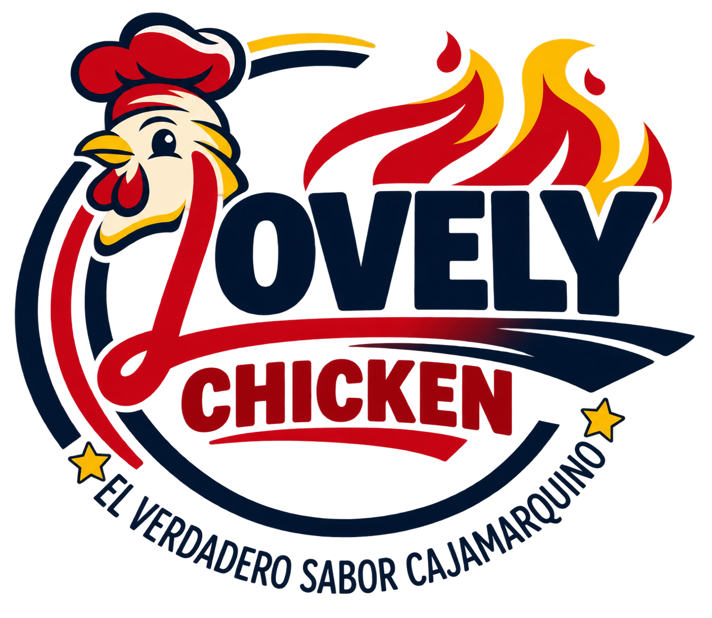
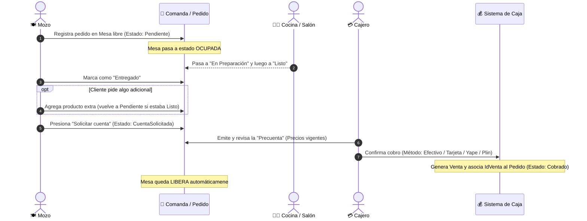
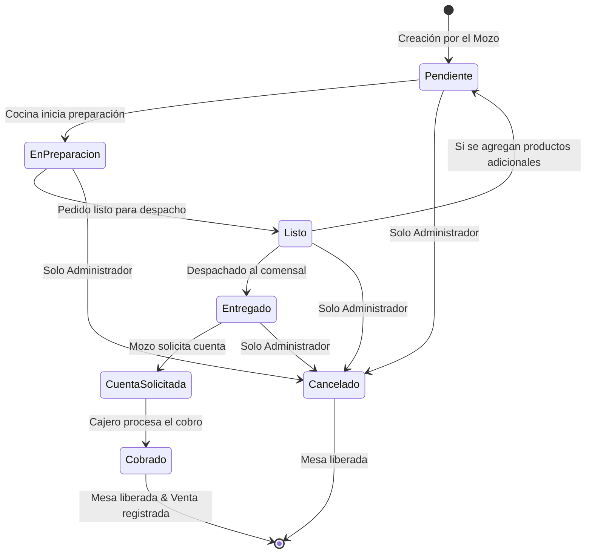

<p align="center">
  
</p>

<h1 align="center"> Pollería Lovely — Sistema de Gestión Gastronómica</h1>

<p align="center">
  <strong>Plataforma web integral para la administración, toma de comandas en salón, facturación, control de caja y analítica financiera para restaurantes y pollerías.</strong>
</p>

<p align="center">
  
  
  
  
  
  
</p>

---

##  Tabla de Contenidos

1. [Visión General](#-visión-general)
2. [Características Principales](#-características-principales)
3. [Flujo Operativo del Negocio](#-flujo-operativo-del-negocio)
4. [Roles y Control de Acceso (RBAC)](#-roles-y-control-de-acceso-rbac)
5. [Módulos del Sistema](#-módulos-del-sistema)
6. [Arquitectura y Stack Tecnológico](#-arquitectura-y-stack-tecnológico)
7. [Seguridad y Reglas de Negocio](#-seguridad-y-reglas-de-negocio)
8. [Estructura del Proyecto](#-estructura-del-proyecto)
9. [Instalación y Configuración](#-instalación-y-configuración)
10. [Cuentas de Prueba para Desarrollo](#-cuentas-de-prueba-para-desarrollo)
11. [Roadmap y Futuras Mejoras](#-roadmap-y-futuras-mejoras)
12. [Créditos y Licencia](#-créditos-y-licencia)

---

##  Visión General

**Pollería Lovely** es un sistema web concebido para optimizar y digitalizar de punta a punta las operaciones de una pollería/restaurante tradicional. Resuelve los cuellos de botella más comunes en el rubro gastronómico:

- ⏳ **Comandas desordenadas y lentitud**: Agiliza la toma de pedidos desde mesas con estados en tiempo real.
- 💵 **Diferencias y fugas en caja**: Control estricto de apertura, arqueo, ventas por método de pago (Efectivo, Tarjeta, Yape/Plin) y cálculo de sobrante/faltante al cierre.
- 🧾 **Manipulación de precios**: El servidor recalcula siempre los importes a partir de los precios vigentes del catálogo, garantizando cobros consistentes e invulnerables a modificaciones en el frontend.
- 📊 **Cálculo de rentabilidad real**: Módulo de reportes que contrasta los ingresos brutos contra los gastos operativos (alquiler, compras, servicios, personal) para determinar la **utilidad estimada** del negocio.

---

##  Características Principales

| Área | Capacidades Clave |
| :--- | :--- |
| **🍽️ Salón y Mesas** | Control de disponibilidad de mesas en vivo, creación de comandas con múltiples ítems, agregación de productos a pedidos abiertos y solicitud de cuenta desde mesa. |
| **💳 Caja y Cobros** | Apertura de turno con monto inicial, consulta de precuentas en solo lectura, cobro directo con múltiples formas de pago y arqueo de caja con control de discrepancias. |
| **📦 Menú e Insumos** | Gestión de productos por categorías, catálogo de insumos de cocina con unidades de medida y directorio de proveedores estratégicos. |
| **📉 Control de Gastos** | Registro clasificado de egresos (Personal, Alquiler, Servicios, Compras, etc.) con anulación lógica para preservar la trazabilidad contable. |
| **📈 Inteligencia de Negocio** | Dashboard interactivo con cálculo de utilidad estimada, ventas agrupadas por cajero, productos más vendidos, recaudación por día y resumen de arqueos. |
| **🛡️ Gestión de Personal** | Administración de cuentas de usuario, asignación de roles, contraseñas protegidas con PBKDF2 y bloqueo automático de autodesactivación para administradores. |

---

##  Flujo Operativo del Negocio

El sistema sincroniza la interacción entre salón, cocina y caja mediante una máquina de estados segura:



### Estados de un Pedido



---

##  Roles y Control de Acceso (RBAC)

La plataforma cuenta con un esquema de autorización estricta basada en roles (`[Authorize(Roles = "...")]`):

```
                                  ┌───────────────────────────┐
                                  │    Autenticación Cookie   │
                                  └─────────────┬─────────────┘
                                                │
                 ┌──────────────────────────────┼──────────────────────────────┐
                 ▼                              ▼                              ▼
      ┌─────────────────────┐        ┌─────────────────────┐        ┌─────────────────────┐
      │   Administrador     │        │      Cajero         │        │       Mozo          │
      ├─────────────────────┤        ├─────────────────────┤        ├─────────────────────┤
      │ • Dashboard global  │        │ • Apertura de caja  │        │ • Dashboard salón   │
      │ • Gestión productos │        │ • Venta de mostrador│        │ • Crear comanda     │
      │ • Categorías/Insumos│        │ • Cobro de comandas │        │ • Agregar extras    │
      │ • Gestión de mesas  │        │ • Emisión precuenta │        │ • Actualizar estado │
      │ • Gestión usuarios  │        │ • Cierre y arqueo   │        │ • Solicitar cuenta  │
      │ • Gastos y egresos  │        │ • Consulta pedidos  │        │ • Ver mesas libres  │
      │ • Reportes utilidad │        └─────────────────────┘        └─────────────────────┘
      │ • Historial ventas  │
      └─────────────────────┘
```

---

##  Módulos del Sistema

### 1. 🍗 Catálogo de Productos y Categorías
- **Categorías**: Clasificación del menú (Pollos, Guarniciones, Bebidas, Promociones, Postres). Protección para evitar el borrado de categorías que contengan productos activos.
- **Productos**: Registro con descripción, precio unitario, stock y categoría.
- **Integridad Referencial**: Regla `ON DELETE RESTRICT` que bloquea la eliminación física de cualquier producto con historial de ventas o pedidos.

### 2. 🪑 Salón y Control de Mesas
- Catálogo de mesas con identificación numérica.
- Detección automática de **disponibilidad en tiempo real**: una mesa se considera ocupada si tiene un pedido en curso (`Estado != Cancelado && Estado != Cobrado`).
- Reglas de negocio para evitar asignar dos pedidos concurrentes a la misma mesa.

### 3. 📝 Comandas y Pedidos en Mesa
- Registro de comanda dinámico sin manipulación de precios (el pedido guarda cantidades e ítems, no importes congelados).
- Capacidad de **adicionar extras** a pedidos en curso mientras el comensal permanezca en salón.
- Selector de estados fluido (`Pendiente` ➔ `En preparación` ➔ `Listo` ➔ `Entregado` ➔ `Cuenta solicitada`).
- Cancelación exclusiva por el Administrador con conservación de auditoría.

### 4. 💵 Gestión de Caja y Arqueo
- **Apertura de turno**: Asignación de caja vinculada al cajero con registro de monto base o saldo inicial.
- **Transacciones por método de pago**: Clasificación de ingresos en `Efectivo`, `Tarjeta`, `Yape / Plin` u `Otro`.
- **Cierre y arqueo de caja**: Comparación automática entre el efectivo esperado según sistema y el dinero contado en físico, calculando automáticamente discrepancias (sobrante o faltante).
- Historial administrativo de turnos de caja para supervisión.

### 5. 🧾 Facturación y Ventas
- **Precuenta**: Vista previa no destructiva con cálculo de precios vigentes para imprimir o mostrar al cliente antes del pago.
- **Cobro seguro y atómico**: Transacción en base de datos con guardas de concurrencia para impedir el doble cobro de un mismo pedido ante clics repetidos.
- **Venta de mostrador**: Posibilidad de registrar ventas directas (takeaway/delivery) sin pasar por el flujo de salón.

### 6. 📉 Control de Gastos Operativos
- Registro de salidas de dinero: `Personal`, `Alquiler`, `Servicios`, `Compras de insumos`, `Mantenimiento` y `Otros`.
- **Anulación lógica**: Los gastos cancelados no se borran físicamente para conservar el historial contable.

### 7. 📊 Analítica y Reportes Financieros
- **Filtro por rango de fechas**: Desde/Hasta personalizable.
- **Métricas de rentabilidad**:
  $$\text{Utilidad Estimada} = \text{Total Ventas} - \text{Total Gastos}$$
- **Ventas por cajero**: Ranking de ventas y recaudación por colaborador.
- **Productos más vendidos**: Listado de demanda por volumen y subtotal generado.
- **Distribución por método de pago** y **recaudación diaria**.

### 8.  Gestión de Personal y Seguridad
- CRUD administrativo de usuarios con selección de rol (`Administrador`, `Cajero`, `Mozo`).
- Hasheo de credenciales con `IPasswordHasher<Usuario>`.
- Reglas anti-bloqueo: el administrador no puede desactivar su propia cuenta ni al último administrador activo del sistema.

---

## 🛠️ Arquitectura y Stack Tecnológico

El proyecto está construido bajo una arquitectura limpia **MVC (Model-View-Controller)** con separación estricta de responsabilidades:

```
PolleriaLovely/
├── Controllers/       # Lógica de aplicación, validaciones de negocio y autorización
├── Models/            # Entidades de dominio, enums y mapeo relacional
├── ViewModels/        # Modelos fuertemente tipados para vistas complejas y reportes
├── Views/             # Plantillas Razor (.cshtml) organizadas por módulo
├── Data/              # DbContext de EF Core, inicializadores y seeds de datos
├── Migrations/        # Historial de migraciones Entity Framework Core
└── wwwroot/           # Recursos estáticos (CSS personalizado, JS, imágenes, Bootstrap)
```

### Tecnologías Utilizadas

| Capa | Componente | Descripción |
| :--- | :--- | :--- |
| **Backend** | [.NET 10](https://dotnet.microsoft.com/) | Runtime de alto rendimiento con C# 13 y Nullable Reference Types. |
| **Framework Web** | [ASP.NET Core MVC](https://learn.microsoft.com/aspnet/core/mvc/overview) | Patrón Controlador-Vista con Tag Helpers y validación de modelos. |
| **ORM** | [Entity Framework Core 10](https://learn.microsoft.com/ef/core/) | Mapeo objeto-relacional con Fluent API, migraciones y LINQ. |
| **Base de Datos** | [Microsoft SQL Server](https://www.microsoft.com/sql-server) | Motor relacional con integridad de claves foráneas e índices. |
| **Autenticación** | `CookieAuthentication` | Autenticación basada en cookies HTTP con claims de rol y usuario. |
| **Criptografía** | `IPasswordHasher<T>` | Algoritmo PBKDF2 para hash y salt seguro de contraseñas. |
| **Frontend** | [Bootstrap 5](https://getbootstrap.com/) + jQuery | Maquetación responsiva, componentes visuales y validación en cliente. |

---

## 🔒 Seguridad y Reglas de Negocio

1. **Cálculo de Precios en Servidor**: El frontend envía únicamente identificadores y cantidades. El servidor consulta los precios directos de base de datos antes de persistir cualquier venta, imposibilitando la alteración maliciosa del total.
2. **Prevención Anti-Doble Cobro**: El cobro de pedidos se ejecuta dentro de transacciones atómicas con validación de concurrencia:
   ```sql
   UPDATE Pedidos SET IdVenta = @IdVenta, Estado = 5 WHERE IdPedido = @Id AND IdVenta IS NULL
   ```
   Si la cantidad de filas afectadas es cero, se anula la transacción previniendo cobros duplicados.
3. **Protección Anti-CSRF**: Formularios protegidos con tokens `@Html.AntiForgeryToken()` y atributos `[ValidateAntiForgeryToken]`.
4. **Protección contra Borrados en Cascada no Deseados**: Claves foráneas configuradas con `DeleteBehavior.Restrict` para resguardar la trazabilidad histórica de ventas y pedidos.
5. **Políticas de Cookies**: Cookies con flags `HttpOnly`, `IsEssential` y expiración deslizable.

---

## 📁 Estructura del Proyecto

```text
SISTEMA-GESTION-POLLERIA/
│
├── SOL_PolleriaLovely.slnx            # Archivo de solución de Visual Studio
├── README.md                          # Documentación principal del repositorio
│
└── PolleriaLovely/                    # Proyecto principal ASP.NET Core MVC
    ├── Controllers/                   # Controladores del sistema
    │   ├── AdministradorController.cs # Panel principal del administrador
    │   ├── CajaController.cs          # Apertura, cierre y arqueo de caja
    │   ├── CajeroController.cs        # Panel principal del cajero
    │   ├── CategoriasController.cs    # Mantenimiento de categorías
    │   ├── GastosController.cs        # Gestión de egresos operativos
    │   ├── HomeController.cs          # Pantalla de bienvenida / Home
    │   ├── InsumosController.cs       # Mantenimiento de insumos
    │   ├── MesasController.cs         # Administración de mesas de salón
    │   ├── MozoController.cs          # Panel principal del mozo
    │   ├── PedidosController.cs       # Flujo de comandas, estados y cobro
    │   ├── ProductosController.cs     # Catálogo de productos y precios
    │   ├── ProveedoresController.cs   # Directorio de proveedores
    │   ├── ReportesController.cs      # Analítica y cálculo de utilidades
    │   ├── UsuarioController.cs       # Login, Logout y control de acceso
    │   ├── UsuariosController.cs      # Mantenimiento de colaboradores
    │   └── VentasController.cs        # Registro de ventas de mostrador
    │
    ├── Data/                          # Acceso a datos
    │   ├── BibliotecaDbContext.cs     # Configuración de DbSets y Fluent API
    │   └── InicializadorDatos.cs      # Creación de roles y mesas iniciales
    │
    ├── Models/                        # Modelos de dominio
    │   ├── Caja.cs                    # Entidad de turno y arqueo de caja
    │   ├── Categoria.cs               # Categorías del menú
    │   ├── DetallePedido.cs           # Líneas de una comanda
    │   ├── DetalleVenta.cs            # Líneas de una venta
    │   ├── EstadoPedido.cs            # Enum de estados de pedidos
    │   ├── Gasto.cs                   # Registro de egresos
    │   ├── Mesa.cs                    # Mesas del salón
    │   ├── MetodoPago.cs              # Enum de medios de pago
    │   ├── Pedido.cs                  # Encabezado de la comanda
    │   ├── Producto.cs                # Producto a la venta
    │   ├── Rol.cs                     # Rol de seguridad
    │   └── Usuario.cs                 # Cuenta de usuario
    │
    ├── ViewModels/                    # Modelos de vista tipados
    │   ├── GastoViewModels.cs
    │   ├── MesaViewModels.cs
    │   ├── PedidoRegistroViewModel.cs
    │   ├── PrecuentaViewModel.cs
    │   ├── ReporteViewModel.cs
    │   └── VentaRegistroViewModel.cs
    │
    ├── Views/                         # Vistas Razor (.cshtml)
    │   ├── Administrador/
    │   ├── Caja/
    │   ├── Cajero/
    │   ├── Categorias/
    │   ├── Gastos/
    │   ├── Insumos/
    │   ├── Mesas/
    │   ├── Mozo/
    │   ├── Pedidos/
    │   ├── Productos/
    │   ├── Proveedores/
    │   ├── Reportes/
    │   ├── Shared/                    # _Layout, vistas parciales, validaciones
    │   ├── Usuario/                   # Login y Acceso Denegado
    │   ├── Usuarios/                  # CRUD de personal
    │   └── Ventas/                    # Venta directa y detalle
    │
    ├── wwwroot/                       # Archivos estáticos servidos al navegador
    │   ├── css/site.css               # Estilos personalizados de la pollería
    │   ├── images/lovely-chicken-logo.png
    │   └── js/site.js
    │
    ├── Program.cs                     # Inyección de dependencias y pipeline HTTP
    └── appsettings.json               # Cadenas de conexión y configuración
```

---

## 🚀 Instalación y Configuración

### 1. Prerrequisitos
Asegúrate de contar con las siguientes herramientas en tu entorno:
- [.NET 10 SDK](https://dotnet.microsoft.com/download/dotnet/10.0) o superior (`dotnet --version`)
- [Microsoft SQL Server](https://www.microsoft.com/sql-server) (2019 o superior / SQL Express / LocalDB)
- [Visual Studio 2026](https://visualstudio.microsoft.com/) (con carga de trabajo ASP.NET y desarrollo web) o [VS Code](https://code.visualstudio.com/) con la extensión de C# Dev Kit.

### 2. Clonar el Repositorio
```bash
git clone https://github.com/3ckokill/SISTEMA-GESTION-POLLERIA.git
cd SISTEMA-GESTION-POLLERIA
```

### 3. Configurar la Cadena de Conexión
Abre el archivo `PolleriaLovely/appsettings.json` y configura la cadena correspondiente a tu instancia de SQL Server:

```json
{
  "ConnectionStrings": {
    "DefaultConnection": "Server=localhost;Database=DB_LovelyChicken;Trusted_Connection=True;TrustServerCertificate=True;MultipleActiveResultSets=true"
  }
}
```

> [!NOTE]
> Verifica que el nombre de conexión en `PolleriaLovely/Program.cs` coincida con la clave seleccionada de tu `appsettings.json`.

### 4. Restaurar Paquetes y Aplicar Migraciones
Ejecuta los siguientes comandos desde tu terminal:

```bash
# Restaurar dependencias de NuGet
dotnet restore

# Posicionarse en el proyecto
cd PolleriaLovely

# Aplicar las migraciones a la base de datos
dotnet ef database update
```

### 5. Compilar y Ejecutar la Aplicación
```bash
dotnet run
```

Abre tu navegador en la URL mostrada en consola (típicamente `https://localhost:7000` o `http://localhost:5000`).

---

## 🔑 Cuentas de Prueba para Desarrollo

En modo **Development**, el sistema inicializa automáticamente los roles del sistema y tres cuentas de prueba seguras para validar cada perfil:

| Rol | Usuario | Contraseña Inicial | Acceso y Capacidades |
| :--- | :--- | :--- | :--- |
|  Administrador | `admin.prueba` | `LovelyDemo2026!` | Acceso completo al sistema, reportes de utilidad, usuarios, productos, gastos y auditoría. |
|  Cajero | `cajero.prueba` | `LovelyCaja2026!` | Apertura y cierre de caja, cobro de comandas, precuentas y ventas de mostrador. |
|  Mozo | `mozo.prueba` | `LovelyMozo2026!` | Toma de pedidos por mesa, adición de extras y cambio de estados en salón. |

> Estas credenciales son generadas exclusivamente con fines didácticos y de pruebas locales. En entornos de producción, las credenciales por defecto se omiten automáticamente.
