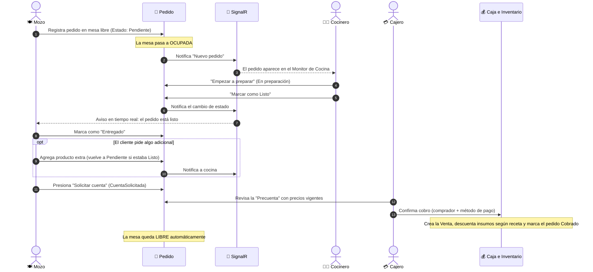
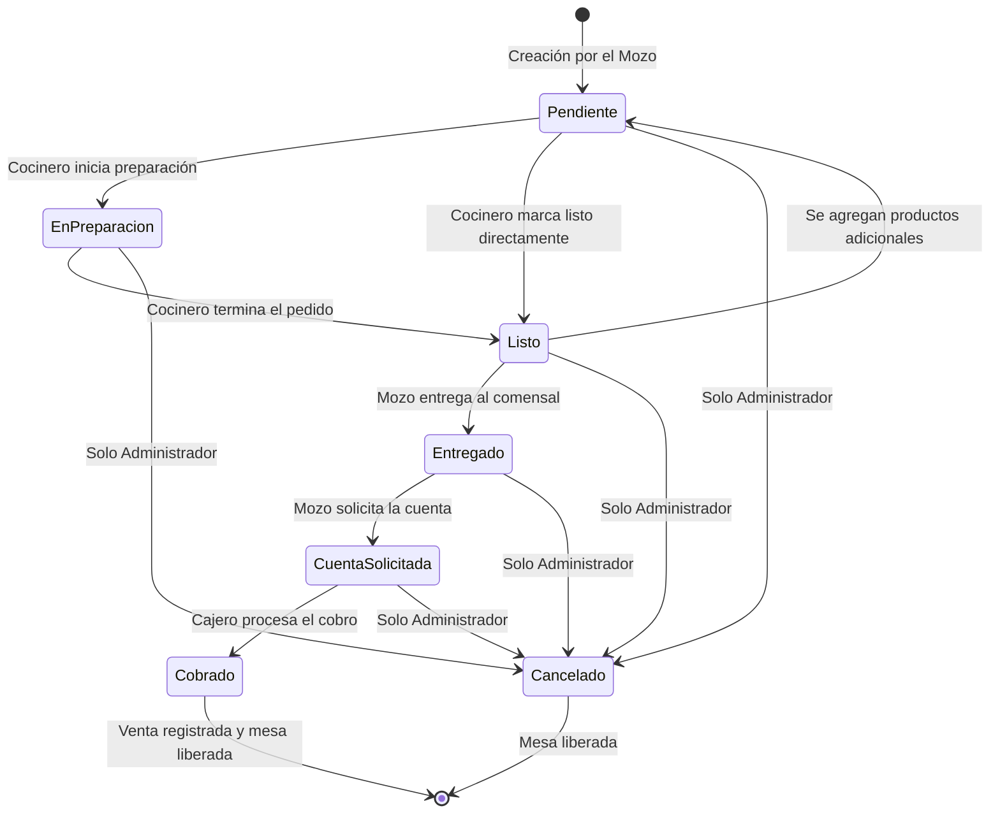

<p align="center">
  
</p>

<h1 align="center">🍗 Pollería Lovely — Sistema de Gestión Gastronómica</h1>

<p align="center">
  <strong>Plataforma web integral para la administración, toma de comandas en salón, monitor de cocina, cobro, control de caja, inventario y analítica financiera para restaurantes y pollerías.</strong>
</p>

<p align="center">
  
  
  
  
  
  
  
</p>

---

## 📑 Tabla de Contenidos

1. [Visión General](#-visión-general)
2. [Características Principales](#-características-principales)
3. [Flujo Operativo del Negocio](#-flujo-operativo-del-negocio)
4. [Roles y Control de Acceso (RBAC)](#-roles-y-control-de-acceso-rbac)
5. [Rol Cocinero: Monitor de Cocina](#-rol-cocinero-monitor-de-cocina)
6. [Módulos del Sistema](#-módulos-del-sistema)
7. [Arquitectura y Stack Tecnológico](#-arquitectura-y-stack-tecnológico)
8. [Seguridad y Reglas de Negocio](#-seguridad-y-reglas-de-negocio)
9. [Validaciones de Datos](#-validaciones-de-datos)
10. [Estructura del Proyecto](#-estructura-del-proyecto)
11. [Instalación y Configuración](#-instalación-y-configuración)
12. [Cuentas de Prueba para Desarrollo](#-cuentas-de-prueba-para-desarrollo)
13. [Roadmap y Futuras Mejoras](#-roadmap-y-futuras-mejoras)
14. [Créditos](#-créditos)

---

## 🎯 Visión General

**Pollería Lovely** es un sistema web concebido para digitalizar de punta a punta las operaciones de una pollería/restaurante tradicional. Conecta **salón, cocina, caja y administración** en un mismo flujo y resuelve los cuellos de botella más comunes del rubro:

- ⏳ **Comandas desordenadas y lentitud**: el mozo registra el pedido y la cocina lo ve al instante en su monitor, sin papeles ni gritos. Todos los roles reciben avisos en tiempo real.
- 💵 **Diferencias y fugas en caja**: control estricto de apertura, arqueo, ventas por método de pago (Efectivo, Tarjeta, Yape/Plin) y cálculo de sobrante/faltante al cierre.
- 🧾 **Manipulación de precios**: el servidor recalcula siempre los importes a partir de los precios vigentes del catálogo, garantizando cobros consistentes e invulnerables a modificaciones en el frontend.
- 📦 **Inventario desconectado de las ventas**: cada producto tiene una receta; al cobrar, el sistema descuenta automáticamente los insumos y rechaza la venta si no hay stock suficiente.
- 📊 **Cálculo de rentabilidad real**: el módulo de reportes contrasta los ingresos contra los gastos operativos para determinar la **utilidad estimada** del negocio.

---

## ✨ Características Principales

| Área | Capacidades Clave |
| :--- | :--- |
| **🍽️ Salón y Mesas** | Control de disponibilidad de mesas en vivo, creación de comandas con múltiples ítems, agregación de productos a pedidos abiertos y solicitud de cuenta desde mesa. |
| **👨‍🍳 Cocina** | Monitor dedicado para el rol Cocinero con la cola de pedidos por orden de llegada, tiempo de espera, y botones para iniciar la preparación y marcar como listo. Se actualiza solo. |
| **📡 Tiempo real** | Avisos instantáneos con SignalR (pedido nuevo, extras, cambio de estado, cobro) para salón, cocina y caja. |
| **💳 Caja y Cobros** | Apertura de turno con monto inicial, precuenta en solo lectura, cobro con múltiples formas de pago, nombre del comprador y arqueo de caja con control de discrepancias. |
| **📦 Menú, Insumos y Recetas** | Productos por categoría, insumos con unidades de medida y stock mínimo, proveedores, recetas por producto y **descuento automático de stock** al vender. |
| **📉 Control de Gastos** | Registro clasificado de egresos (Personal, Alquiler, Servicios, Compras, etc.) con anulación lógica para preservar la trazabilidad contable. |
| **📈 Inteligencia de Negocio** | Reportes con utilidad estimada, ventas por cajero, productos más vendidos, recaudación por día, método de pago y resumen de arqueos. Exportación a **PDF** y **CSV**. |
| **🛡️ Gestión de Personal** | Administración de cuentas y roles, contraseñas protegidas con PBKDF2, bloqueo de autodesactivación y **cierre automático de sesión** al inhabilitar a un usuario. |

---

## 🔄 Flujo Operativo del Negocio

El sistema sincroniza salón, cocina y caja mediante una máquina de estados segura y avisos en tiempo real:



### Estados de un Pedido



> **Notas:**
> - El **Cocinero** solo puede mover pedidos a *En preparación* o *Listo*; ningún otro estado le está permitido.
> - El **Cajero** puede cobrar un pedido desde cualquier estado abierto (aunque no haya pasado por «Cuenta solicitada»). Un pedido cobrado o cancelado es **final**.
> - Una mesa permanece ocupada mientras su pedido no esté *Cobrado* ni *Cancelado*.

---

## 🔐 Roles y Control de Acceso (RBAC)

La autorización se aplica en el servidor con `[Authorize(Roles = "...")]`. Ocultar un botón no es seguridad: aunque alguien escriba la URL a mano, el controlador rechaza la acción.

| Rol | Pantalla de inicio | Capacidades |
| :--- | :--- | :--- |
| 👑 **Administrador** | Panel del administrador | Gestión de productos, categorías, insumos, proveedores y **recetas**; mesas; usuarios; gastos; reportes y exportación; historial de ventas y de cajas; **cancelación de pedidos**; acceso también al Monitor de Cocina. |
| 💳 **Cajero** | Panel del cajero | Apertura y cierre de caja, venta de mostrador, precuenta y cobro de pedidos, consulta de pedidos (solo lectura). |
| 🍽️ **Mozo** | Panel del mozo | Crear pedidos en mesas libres, agregar extras, actualizar estados de salón, solicitar la cuenta. No puede cancelar. |
| 👨‍🍳 **Cocinero** | **Monitor de Cocina** | Ver la cola de pedidos pendientes y en preparación, iniciar la preparación y marcar como listo. Nada más. |

Al iniciar sesión, cada rol es redirigido automáticamente a su pantalla. Si un usuario **es inhabilitado** o eliminado, su sesión se cierra en la siguiente petición aunque su cookie siga vigente.

---

## 👨‍🍳 Rol Cocinero: Monitor de Cocina

El **Cocinero** trabaja desde una pantalla única, el **Monitor de Cocina** (`/Cocina/Index`), pensada para usarse en una tablet o monitor de cocina sin distracciones.

**Qué ve**
- Tarjetas tipo *comanda* con: número de pedido, **mesa**, hora de ingreso, **minutos de espera**, mozo que lo registró y la lista de productos con cantidades (`2×`, `1×`…).
- Solo pedidos en estado **Pendiente** o **En preparación**, ordenados por **orden de llegada** (los más antiguos arriba).
- Un contador de pedidos pendientes y en preparación, y un aviso cuando la cola está vacía.

**Qué puede hacer**

| Acción | Resultado |
| :--- | :--- |
| **Empezar a preparar** | El pedido pasa de *Pendiente* a *En preparación*. |
| **Marcar como Listo** | El pedido pasa a *Listo* y el mozo recibe el aviso para entregarlo. |

**Reglas y protecciones**
- Solo puede asignar *En preparación* o *Listo*; cualquier otro estado es rechazado por el servidor.
- Si el pedido ya no está en la cola de cocina (por ejemplo, fue cancelado o cobrado), se muestra un mensaje y no se modifica.
- No tiene acceso a ventas, caja, reportes ni usuarios.

**Tiempo real**
- La pantalla escucha el hub `/hubs/pedidos` de **SignalR**. Cuando el mozo registra un pedido nuevo o agrega extras, aparece un aviso y la lista se recarga sola, sin pulsar nada.
- Existe además el botón **«Actualizar ahora»** como respaldo si la conexión en tiempo real no está disponible.

**Cómo probarlo**
1. Entra como `mozo.prueba` y registra un pedido en una mesa libre.
2. En otra ventana (o navegador) entra como `cocinero.prueba`: el pedido aparece en el monitor.
3. Pulsa **Empezar a preparar** y luego **Marcar como Listo**; el mozo ve el cambio de estado.

---

## 🧩 Módulos del Sistema

### 1. 🍗 Catálogo de Productos y Categorías
- **Categorías**: clasificación del menú (Pollos, Acompañamientos, Bebidas, Postres…). No se puede borrar una categoría que tenga productos.
- **Productos**: nombre, descripción, precio unitario, estado y categoría.
- **Integridad referencial**: regla `ON DELETE RESTRICT` que bloquea la eliminación física de cualquier producto con historial de ventas o pedidos.

### 2. 📦 Insumos, Proveedores y Recetas
- **Insumos** con unidad de medida (Kilogramo, Gramo, Litro, Mililitro, Unidad, Docena, Caja, Quintal, Bulto), stock actual y **stock mínimo**, con alerta visual de «Stock bajo».
- **Registrar entrada** de mercadería para sumar stock.
- **Proveedores** con RUC único de 11 dígitos, teléfono y dirección.
- **Recetas**: cada producto define cuánto consume de cada insumo por unidad (por ejemplo, ¼ de pollo → 0.375 kg de pollo entero + papas + aderezos).
- **Descuento automático**: al registrar una venta directa o cobrar un pedido, el `InventarioService` calcula el consumo total agrupado por insumo. Si algún insumo no alcanza, la operación se **rechaza completa** y no se modifica nada, indicando qué insumo falta y cuánto.

### 3. 🪑 Salón y Control de Mesas
- Mantenimiento de mesas (alta, edición, activar/desactivar). No se borran físicamente para conservar el historial.
- **Disponibilidad calculada**: una mesa está ocupada si tiene un pedido en curso (`Estado != Cancelado && Estado != Cobrado`).
- No se permite asignar dos pedidos a la misma mesa ni desactivar una mesa con pedido abierto.

### 4. 📝 Comandas y Pedidos en Mesa
- Registro dinámico de comandas **sin precios congelados**: el pedido guarda ítems y cantidades; el precio se toma al cobrar.
- **Extras** sobre pedidos en curso; si el pedido estaba *Listo*, vuelve a *Pendiente* para que cocina lo atienda.
- Selector de estados por rol y cancelación exclusiva del Administrador, con conservación de auditoría.
- Límites de negocio: máximo 99 unidades por línea, 20 líneas y 200 unidades por pedido.

### 5. 👨‍🍳 Cocina
Descrita en detalle en la sección [Rol Cocinero](#-rol-cocinero-monitor-de-cocina).

### 6. 💵 Gestión de Caja y Arqueo
- **Apertura de turno**: caja vinculada al cajero con monto inicial. Sin caja abierta no se puede vender ni cobrar.
- **Ventas por método de pago**: `Efectivo`, `Tarjeta`, `Yape / Plin` u `Otro`.
- **Cierre y arqueo**: el efectivo esperado es `monto inicial + ventas en efectivo`; el cajero ingresa lo contado y el sistema calcula la diferencia (sobrante o faltante).
- Historial de turnos para supervisión del administrador.

### 7. 🧾 Ventas y Facturación
- **Precuenta**: vista previa **solo lectura** con los precios vigentes, antes del pago.
- **Cobro seguro y atómico**: transacción con guardas de concurrencia que impide el doble cobro ante clics repetidos.
- **Nombre del comprador**: obligatorio en toda venta (de mostrador o cobro de pedido).
- **Venta de mostrador**: registro de ventas directas (takeaway/delivery) sin pasar por el flujo de salón.
- Historial y detalle de ventas para el administrador.

### 8. 📉 Control de Gastos Operativos
- Egresos clasificados: `Servicios`, `Alquiler`, `Personal`, `Compras`, `Mantenimiento` y `Otros`, con método de pago y observaciones.
- **Anulación lógica**: los gastos anulados no se borran y dejan de contar en la utilidad.

### 9. 📊 Analítica y Reportes Financieros
- **Filtro por rango de fechas** (el día final se incluye completo).
- **Rentabilidad**:
  $$\text{Utilidad Estimada} = \text{Total Ventas} - \text{Total Gastos}$$
- Total vendido, cantidad de ventas y promedio por venta.
- Ventas por cajero, por día y por método de pago; productos más vendidos; resumen por caja con efectivo esperado, contado y diferencia.
- **Exportación**: descarga en **PDF** (generado en el servidor con QuestPDF) y en **CSV** (UTF-8 con ventas, gastos y utilidad).

### 10. 🛡️ Gestión de Personal y Seguridad
- CRUD de usuarios con selección de rol (`Administrador`, `Cajero`, `Mozo`, `Cocinero`).
- Correo y nombre de usuario únicos; contraseña mínima de 6 caracteres; en edición, dejar la contraseña vacía conserva la actual.
- Hasheo de credenciales con `IPasswordHasher<Usuario>`; el hash nunca se muestra en pantalla.
- Reglas anti-bloqueo: no se puede desactivar ni eliminar la propia cuenta, ni al último administrador activo. Un usuario con ventas o pedidos no se elimina: se **desactiva**.

---

## 🛠️ Arquitectura y Stack Tecnológico

El proyecto sigue una arquitectura **MVC (Model-View-Controller)** con separación de responsabilidades:

```
PolleriaLovely/
├── Controllers/       # Lógica de aplicación, validaciones de negocio y autorización
├── Models/            # Entidades de dominio, enums y reglas de negocio
├── ViewModels/        # Modelos tipados para formularios, vistas complejas y reportes
├── Views/             # Plantillas Razor (.cshtml) organizadas por módulo
├── Services/          # Lógica reutilizable (InventarioService)
├── Hubs/              # SignalR: notificaciones en tiempo real
├── Documents/         # Generación de PDF (QuestPDF)
├── Data/              # DbContext de EF Core, inicializadores y semillas
├── Migrations/        # Historial de migraciones de Entity Framework Core
├── Scripts/           # Scripts SQL de datos de ejemplo
└── wwwroot/           # Recursos estáticos (CSS, JS, imágenes, Bootstrap)
```

### Tecnologías Utilizadas

| Capa | Componente | Descripción |
| :--- | :--- | :--- |
| **Backend** | [.NET 10](https://dotnet.microsoft.com/) | Runtime con C# y Nullable Reference Types. |
| **Framework Web** | [ASP.NET Core MVC](https://learn.microsoft.com/aspnet/core/mvc/overview) | Controlador-Vista con Tag Helpers y validación de modelos. |
| **ORM** | [Entity Framework Core 10](https://learn.microsoft.com/ef/core/) | Fluent API, migraciones y LINQ. |
| **Base de Datos** | [Microsoft SQL Server](https://www.microsoft.com/sql-server) | Integridad de claves foráneas y tipos `decimal` para dinero. |
| **Tiempo real** | [ASP.NET Core SignalR](https://learn.microsoft.com/aspnet/core/signalr/introduction) | Hub `/hubs/pedidos` para avisos entre salón, cocina y caja. |
| **Autenticación** | `CookieAuthentication` | Cookies HTTP con claims de rol y usuario, validadas contra la base en cada petición. |
| **Criptografía** | `IPasswordHasher<T>` | PBKDF2 con salt para las contraseñas. |
| **Reportes PDF** | [QuestPDF](https://www.questpdf.com/) | Generación de PDF en el servidor (licencia Community). |
| **Frontend** | [Bootstrap 5](https://getbootstrap.com/) + jQuery | Maquetación responsiva y validación en cliente. |

---

## 🔒 Seguridad y Reglas de Negocio

1. **Cálculo de precios en el servidor**: el frontend envía solo identificadores y cantidades; el servidor consulta los precios en la base antes de guardar cualquier venta.
2. **Prevención anti doble cobro**: el cobro corre en una transacción con una actualización condicional:
   ```sql
   UPDATE Pedidos SET IdVenta = @IdVenta, Estado = 5 WHERE IdPedido = @Id AND IdVenta IS NULL
   ```
   Si no se afecta ninguna fila, se anula la transacción.
3. **Inventario consistente**: el descuento de insumos y la venta se guardan en la misma transacción; si falta stock no se guarda nada.
4. **Autorización por rol en cada controlador** y también en el hub de SignalR (solo usuarios autenticados con rol del sistema).
5. **Sesión ligada al estado del usuario**: si un administrador inhabilita o elimina una cuenta, su sesión se invalida en la siguiente petición.
6. **Protección Anti-CSRF**: formularios con token y `[ValidateAntiForgeryToken]`.
7. **Sin borrados en cascada peligrosos**: claves foráneas con `DeleteBehavior.Restrict` para resguardar el historial de ventas y pedidos.
8. **Cookies seguras**: `HttpOnly`, `IsEssential` y expiración deslizante.
9. **Credenciales de prueba solo en Development**: no se crean en producción.

---

## ✅ Validaciones de Datos

Las reglas se aplican **en el navegador y en el servidor** (nunca se confía solo en el cliente):

| Campo | Regla |
| :--- | :--- |
| Nombres (categoría, producto, insumo, proveedor, nombre y apellido de usuario, comprador) | Solo letras (con tildes, ñ y ü) y espacios entre palabras. |
| Descripciones (categoría, producto, gasto) | Más de 10 caracteres, sin contar espacios al inicio o al final. Se guardan recortadas. En producto es opcional. |
| Nombre del comprador | Obligatorio en toda venta, máximo 100 caracteres. |
| RUC del proveedor | Exactamente 11 dígitos y único. |
| Teléfono | Solo dígitos, hasta 9. |
| Correo de usuario | Formato válido y único. |
| Precio y stock | Rangos validados; admiten coma o punto decimal. |
| Cantidades por línea | De 1 a 99 unidades. |

---

## 📁 Estructura del Proyecto

```text
SISTEMA-GESTION-POLLERIA/
│
├── SOL_PolleriaLovely.slnx            # Solución de Visual Studio
├── README.md                          # Documentación principal
│
└── PolleriaLovely/                    # Proyecto ASP.NET Core MVC
    ├── Controllers/
    │   ├── AdministradorController.cs # Panel del administrador
    │   ├── CajaController.cs          # Apertura, cierre y arqueo de caja
    │   ├── CajeroController.cs        # Panel del cajero
    │   ├── CategoriasController.cs    # Categorías del menú
    │   ├── CocinaController.cs        # Monitor de cocina y cambio de estado (Cocinero)
    │   ├── GastosController.cs        # Egresos operativos
    │   ├── HomeController.cs          # Bienvenida
    │   ├── InsumosController.cs       # Insumos, stock y entradas
    │   ├── MesasController.cs         # Mesas del salón
    │   ├── MozoController.cs          # Panel del mozo
    │   ├── PedidosController.cs       # Comandas, estados, precuenta y cobro
    │   ├── ProductosController.cs     # Catálogo y precios
    │   ├── ProveedoresController.cs   # Directorio de proveedores
    │   ├── RecetasController.cs       # Receta de cada producto
    │   ├── ReportesController.cs      # Analítica, PDF y CSV
    │   ├── UsuarioController.cs       # Login y Logout
    │   ├── UsuariosController.cs      # Mantenimiento de personal
    │   └── VentasController.cs        # Ventas de mostrador e historial
    │
    ├── Data/
    │   ├── BibliotecaDbContext.cs     # DbSets y Fluent API
    │   └── InicializadorDatos.cs      # Roles (4) y 10 mesas iniciales
    │
    ├── Documents/
    │   └── ReportePdfDocument.cs      # Diseño del reporte en PDF
    │
    ├── Hubs/
    │   └── PedidosHub.cs              # Hub de SignalR (/hubs/pedidos)
    │
    ├── Models/                        # Caja, Categoria, DetallePedido, DetalleVenta,
    │                                  # EstadoPedido, Gasto, Insumo, Mesa, MetodoPago,
    │                                  # Pedido, Producto, ProductoInsumo, Proveedor,
    │                                  # ReglasNegocio, Rol, Usuario, Venta
    │
    ├── Services/
    │   └── InventarioService.cs       # Cálculo y descuento de insumos por receta
    │
    ├── Scripts/
    │   └── CargarDatosPolleriaAcademica.sql  # Insumos, productos y recetas de ejemplo
    │
    ├── ViewModels/                    # Modelos tipados de caja, gastos, insumos,
    │                                  # login, mesas, pedidos, recetas, reportes y ventas
    │
    ├── Views/                         # Administrador, Caja, Cajero, Categorias, Cocina,
    │                                  # Gastos, Insumos, Mesas, Mozo, Pedidos, Productos,
    │                                  # Proveedores, Recetas, Reportes, Shared, Usuario,
    │                                  # Usuarios y Ventas
    │
    ├── wwwroot/                       # CSS, JS, imágenes y librerías
    ├── Program.cs                     # Servicios, autenticación, hub, semillas y rutas
    └── appsettings.json               # Cadenas de conexión y configuración
```

---

## 🚀 Instalación y Configuración

### 1. Prerrequisitos
- [.NET 10 SDK](https://dotnet.microsoft.com/download/dotnet/10.0) o superior (`dotnet --version`)
- [Microsoft SQL Server](https://www.microsoft.com/sql-server) (2019 o superior, SQL Express o LocalDB)
- [Visual Studio 2026](https://visualstudio.microsoft.com/) con la carga de trabajo ASP.NET y desarrollo web, o VS Code con C# Dev Kit
- Herramienta de EF Core: `dotnet tool install --global dotnet-ef` (si usas la terminal)

### 2. Clonar el repositorio
```bash
git clone https://github.com/3ckokill/SISTEMA-GESTION-POLLERIA.git
cd SISTEMA-GESTION-POLLERIA
```

### 3. Configurar la cadena de conexión
Abre `PolleriaLovely/appsettings.json` y ajusta el servidor a tu instancia de SQL Server. **La aplicación lee la clave `ThirdDefaultConnection`** (ver `Program.cs`):

```json
{
  "ConnectionStrings": {
    "ThirdDefaultConnection": "Server=localhost;Database=DB_LovelyChicken;Trusted_Connection=True;TrustServerCertificate=True;MultipleActiveResultSets=true"
  }
}
```

> [!IMPORTANT]
> **Los datos no viajan con el repositorio.** Cada persona usa su propia base de datos local, que empieza vacía. Lo que guardes desde el sistema (productos, ventas, usuarios creados a mano) queda en tu SQL Server y no se sube a Git.
> Si tu servidor es distinto (por ejemplo `.\SQLEXPRESS`), evita subir ese cambio al repositorio para no afectar a tus compañeros.

### 4. Crear la base de datos
Desde la carpeta `PolleriaLovely`:

```bash
dotnet restore
dotnet ef database update
```

En Visual Studio, desde la *Consola del Administrador de paquetes*: `Update-Database`.

Al iniciar la aplicación se crean automáticamente los **4 roles** y las **10 mesas**; en modo Development también las cuentas de prueba.

### 5. (Opcional) Cargar datos de ejemplo
Para tener un menú y recetas listos para probar el descuento de inventario:

1. Entra como `admin.prueba` y crea los **proveedores** `Avicola El plumas`, `Verduras Campo` y `Mayorista Juan`, y las **categorías** «Pollos a la brasa» y «Acompañamientos».
2. Ejecuta `PolleriaLovely/Scripts/CargarDatosPolleriaAcademica.sql` en SQL Server Management Studio.

El script es idempotente: crea 15 insumos, 5 productos y 55 líneas de receta sin duplicar. Si faltan proveedores o categorías, se detiene con un mensaje claro.

> [!NOTE]
> Algunos productos de ejemplo (como «1/4 Pollo a la Brasa») contienen números; con la validación de nombres solo letras, habrá que renombrarlos si se editan desde la pantalla.

### 6. Compilar y ejecutar
```bash
dotnet run
```

Abre la URL que muestre la consola (típicamente `https://localhost:7000` o `http://localhost:5000`). La ruta raíz lleva al login; para entrar directo a un módulo usa `/Modulo/Accion` (por ejemplo `/Productos/Index`).

> [!TIP]
> Si `dotnet ef` o la compilación falla con errores de archivos bloqueados, detén la aplicación en ejecución (Shift+F5 en Visual Studio) y vuelve a intentar.

---

## 🔑 Cuentas de Prueba para Desarrollo

En modo **Development**, el sistema crea los roles y **cuatro cuentas de prueba**, una por rol:

| Rol | Usuario | Contraseña inicial | Pantalla de inicio y capacidades |
| :--- | :--- | :--- | :--- |
| 👑 Administrador | `admin.prueba` | `LovelyDemo2026!` | Acceso completo: reportes, usuarios, productos, recetas, gastos y auditoría. |
| 💳 Cajero | `cajero.prueba` | `LovelyCaja2026!` | Apertura y cierre de caja, cobro de comandas, precuentas y ventas de mostrador. |
| 🍽️ Mozo | `mozo.prueba` | `LovelyMozo2026!` | Toma de pedidos por mesa, extras y cambio de estados en salón. |
| 👨‍🍳 Cocinero | `cocinero.prueba` | `LovelyCocina2026!` | Monitor de Cocina: iniciar preparación y marcar pedidos como listos. |

> Estas credenciales son solo para pruebas locales y fines didácticos. En producción no se crean. Si una cuenta ya existía, el inicializador no cambia su contraseña ni su rol.

---

## 🗺️ Roadmap y Futuras Mejoras

- 📜 **Historial de movimientos de inventario** (quién, cuándo y por qué cambió el stock).
- ⏱️ **Alertas por tiempo de espera** en el Monitor de Cocina (resaltar pedidos que superan cierto tiempo) y aviso sonoro de pedido nuevo.
- 📝 **Notas por ítem** en la comanda («sin ensalada», «bien dorado»).
- 🔀 **División de cuenta** entre varios comensales.
- 🧾 **Comprobantes electrónicos** (boleta y factura).
- 📱 **Vista optimizada para tablet** del salón y la cocina.
- 🧪 **Pruebas automatizadas** de los flujos críticos (cobro, inventario y permisos).

---

## 👥 Créditos

Proyecto desarrollado con fines académicos y didácticos como sistema de gestión para la pollería **Lovely Chicken**.
Repositorio: [github.com/3ckokill/SISTEMA-GESTION-POLLERIA](https://github.com/3ckokill/SISTEMA-GESTION-POLLERIA)
